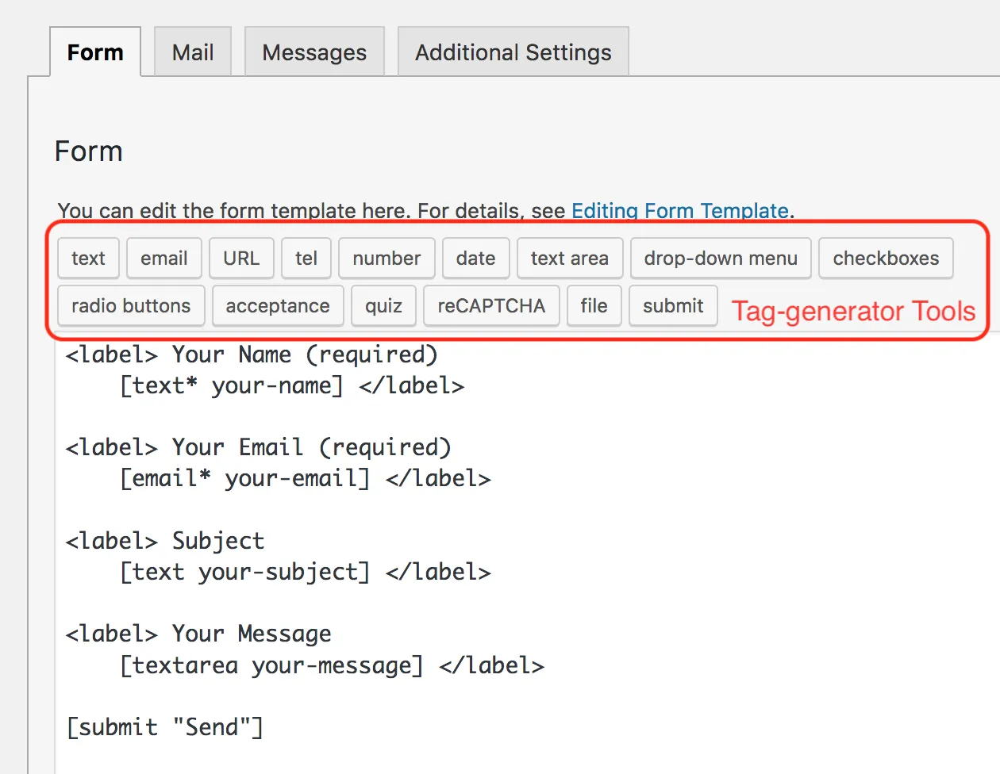

您可以在“[表单”选项卡面板中](https://contactform7.com/admin-screen/)编辑联系表单的表单模板。HTML 和 Contact Form 7 的[表单标签](https://contactform7.com/tag-syntax/)可用于表单模板。
表单标签用作 HTML 表单控件（例如文本输入字段）或一组表单控件（例如一组复选框）的占位符。呈现表单时，表单标签被 HTML 替换。
表单标签必须遵循特定的[语法规则](https://contactform7.com/tag-syntax/)。否则，表单标签将无法正常工作。不过，没有必要记住语法，因为您可以使用标签生成器工具来生成正确的表单标签。

“表单”选项卡面板的屏幕截图

 
请注意，表单模板中的更改不会自动反映在联系表单的邮件设置中。因此，如果您已将表单标签添加到表单模板，则需要在“[邮件”](https://contactform7.com/setting-up-mail/)[选项卡面板](https://contactform7.com/setting-up-mail/)中的邮件设置中手动[添加相应](https://contactform7.com/tag-syntax/)的[邮件标签](https://contactform7.com/setting-up-mail/)。
