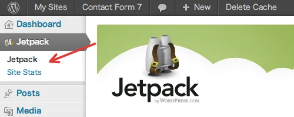
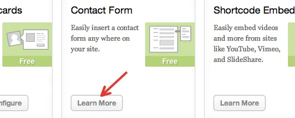
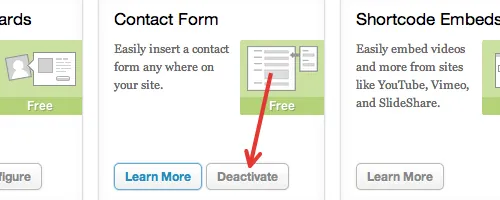

Jetpack是一种流行的插件，可让您在自托管的 WordPress 站点上利用[WordPress.com](https://wordpress.com/ "WordPress.com") 的许多功能。我喜欢 Jetpack 并在我的许多网站上使用它。
不幸的是，Jetpack 的联系表单模块是 Jetpack 1.3 新引入的，与其他联系表单插件（包括 Contact Form 7）冲突。
一个典型的问题是 Jetpack 劫持了其他插件的联系表单短代码。因此，您的自定义联系表单将被 Jetpack 的普通联系表单替换，并且提交的消息可能会发送到非预期的目的地。
我将在此处发布如何避免 Jetpack 问题并成功将 Contact Form 7 与 Jetpack 结合使用。

#### 停用 Jetpack 的联系表单模块

您可以停用联系表单模块并继续使用 Jetpack 的其他功能。如果您打算使用联系表单以外的 Jetpack 功能，这是避免问题的最简单方法。
您可以在 Jetpack 的管理屏幕上停用特定功能，但该过程令人困惑。请参阅以下步骤。

1. 打开 Jetpack 菜单
   
2. 单击“联系表单”窗格中的“了解更多”，
   
   然后出现“停用”按钮
3. 点击“停用”
   

#### 使用新的简码

Contact Form 7[contact-form-7 ...]默认使用简码格式，但使用[contact-form ...]Contact Form 7 v3.0 之前的格式。[contact-form ...]仍然支持旧的简码以实现向后兼容性。
使用旧简码的问题在于简码的名称“contact-form”是一个常用词，因此其他插件可能使用相同的名称。Jetpack 使用[contact-form ...]. 当多个插件使用同名的短代码时，会导致冲突。
您可以通过用新的短代码手动替换旧的短代码来最大程度地减少冲突。
