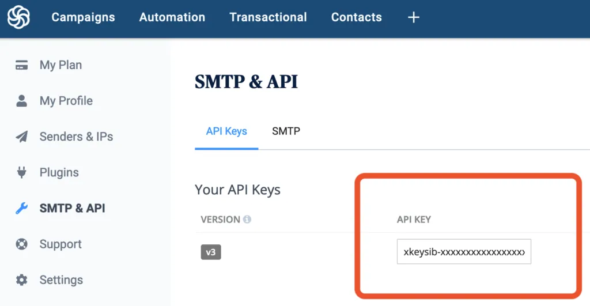
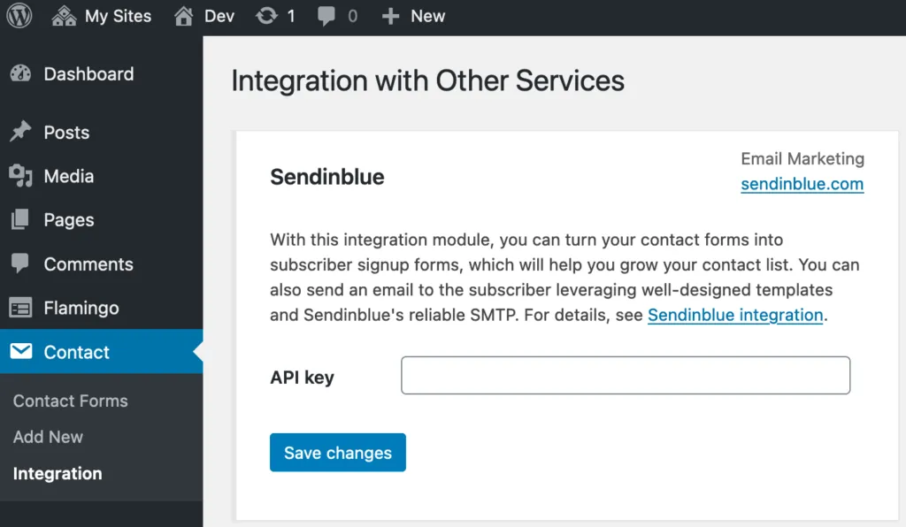
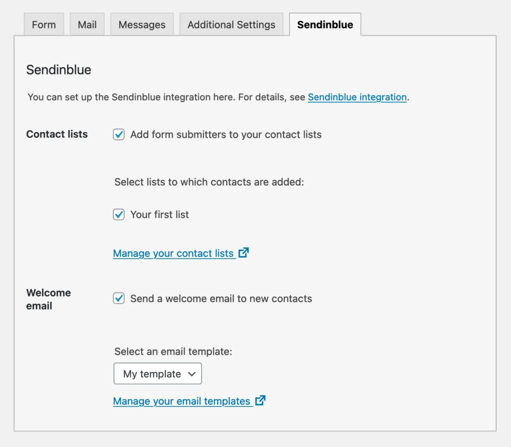

**披露：这篇文章的作者是 Sendinblue 的附属机构，这意味着如果您决定通过插件作者的链接进行购买，插件作者将获得佣金，您无需支付任何费用。**
[](https://www.sendinblue.com/?tap_a=50905-b26a4f&tap_s=1031580-b1bb1d)
 
在欧洲领先的 CRM 和电子邮件营销平台[Sendinblue](https://www.sendinblue.com/?tap_a=30591-fb13f0&tap_s=1031580-b1bb1d)上存储和组织您的联系人，同时保护用户隐私。Sendinblue 提供无限的联系方式和高级营销功能。

1. [连接到 API](#connecting-to-the-api)
2. [设置您的联系表格](#setting-up-your-contact-forms)
3. [联系人属性-表单字段映射](#contact-attribute-form-field-mapping)
4. [隐私考虑](#privacy-considerations)

#### 连接到 API

此集成模块使用 Sendinblue API (v3)。要访问 API，您需要一个 Sendinblue 帐户。如果您还没有，请先[创建一个免费帐户](https://www.sendinblue.com/pricing/?tap_a=30591-fb13f0&tap_s=1031580-b1bb1d)。您可以随时升级帐户。
创建帐户后，登录 Sendinblue 仪表板并导航到[SMTP & API](https://account.sendinblue.com/advanced/api?tap_a=30591-fb13f0&tap_s=1031580-b1bb1d)页面。你会在那里找到你的 v3 API 密钥。这个密钥在下一步中使用，所以现在复制它。


“SMTP & API”页面的屏幕截图

 
然后打开一个新的浏览器选项卡并登录到您的 WordPress 仪表板。导航到联系人 > 集成菜单页面，然后单击Sendinblue 框中的设置集成。您会在那里找到一个输入字段。将 API 密钥粘贴到该字段中，然后单击Save changes。


集成页面的屏幕截图

 
现在 Sendinblue API 可通过您的联系表格获得。下一步是设置每个联系表格。

#### 设置您的联系表格

激活 Sendinblue API 后，您将在[联系表单编辑器屏幕中](https://contactform7.com/admin-screen/)找到一个新创建的选项卡。使用这个Sendinblue选项卡面板，您可以控制这个集成模块的两个主要功能：联系人列表和欢迎电子邮件。


Sendinblue 选项卡面板的屏幕截图

 
如果选中“联系人列表”复选框，则提交者将在提交联系表单后添加到您的联系人列表中。您还可以指明联系人将添加到哪些[列表](https://my.sendinblue.com/lists?tap_a=30591-fb13f0&tap_s=1031580-b1bb1d)中。
如果选中欢迎电子邮件复选框，联系表 7 将向新联系人发送欢迎电子邮件。仅当提交者成功添加到联系人列表时才会发送欢迎电子邮件。
欢迎电子邮件使用 Sendinblue 的[电子邮件模板](https://my.sendinblue.com/camp/lists/template?tap_a=30591-fb13f0&tap_s=1031580-b1bb1d)系统，可让您撰写完全个性化、优雅的 HTML 电子邮件。此外，电子邮件是通过 Sendinblue 可靠的 SMTP 基础设施传送的，这使您可以在发送后跟踪电子邮件的状态。
注意：联系表 7 仅使用 Sendinblue 的 SMTP 作为新联系人的欢迎电子邮件。欢迎电子邮件以外的电子邮件使用 WordPress 的内置wp\_mail()功能。如果您想对 WordPress 上的每封电子邮件使用 Sendinblue 的 SMTP，请安装[Sendinblue 的官方 WordPress 插件](https://wordpress.org/plugins/mailin/)。

#### 联系人属性-表单字段映射

Sendinblue 的联系人数据由四个基本属性（EMAIL、FIRSTNAME、LASTNAME 和 SMS）和用户定义的附加属性组成。当您根据表单提交创建新联系人时，将从用户输入值中检索这些联系人属性。
例如，从“您的电子邮件”字段中检索 EMAIL 属性。以同样的方式，从名称包含[“your-”前缀](https://contactform7.com/faq/why-do-field-names-start-with-your/)+小写的属性名称的表单字段中检索属性。
此外，FIRSTNAME 和 LASTNAME 有一个特殊的映射规则。对于表单不包含“您的名字”或“您的姓氏”字段而是包含“您的姓名”字段的情况，“您的姓名”字段值的第一个单词用于 FIRSTNAME 属性，其余部分用于 LASTNAME 属性。因此，例如，如果在“您的姓名”字段中输入“文森特·梵高”，则 FIRSTNAME 将是“Vincent”，而 LASTNAME 将是“van Gogh”。
另请注意，[必须将](https://developers.sendinblue.com/reference#createcontact)SMS 属性值[指定为具有正确国家/地区代码的国际电话号码](https://developers.sendinblue.com/reference#createcontact)（例如：+91xxxxxxxxxx 或 0091xxxxxxxxxx）。如果您有 SMS 的输入字段并且用户输入的格式不正确，则创建联系人的 API 请求将失败。
[电子邮件模板中使用](https://help.sendinblue.com/hc/en-us/articles/360000268730-Using-Sendinblue-s-New-Template-Language-to-create-email-templates-and-campaigns-NEW-?tap_a=30591-fb13f0&tap_s=1031580-b1bb1d)的[参数](https://help.sendinblue.com/hc/en-us/articles/360000268730-Using-Sendinblue-s-New-Template-Language-to-create-email-templates-and-campaigns-NEW-?tap_a=30591-fb13f0&tap_s=1031580-b1bb1d)遵循相同的映射规则。如果您{{ params.SIZE }}的电子邮件模板中有占位符，则“您的大小”字段值将替换电子邮件中的占位符。
最后，您可以使用wpcf7\_sendinblue\_collect\_parameters过滤器钩子自定义整个映射。

#### 隐私考虑

强烈建议您在将他们的个人数据添加到您的联系人列表之前获得表单提交者的明确同意。未经同意收集个人数据不仅是非法的，而且如果将电子邮件发送给非预期的接收者，也可能导致垃圾邮件投诉率很高。
联系表格 7 提供了consent\_for:sendinblue表单标签选项来检查提交者的同意，下面提供了一个例子：

```
[acceptance your-consent optional consent_for:sendinblue]
It's OK to add me to your contact list.
[/acceptance]
```

如果您的联系表单中有此表单标记（[接受复选框](https://contactform7.com/acceptance-checkbox/)），则仅当提交者选中该复选框以确认他们的同意时，联系表单 7 才会将联系数据发送到 Sendinblue API。
