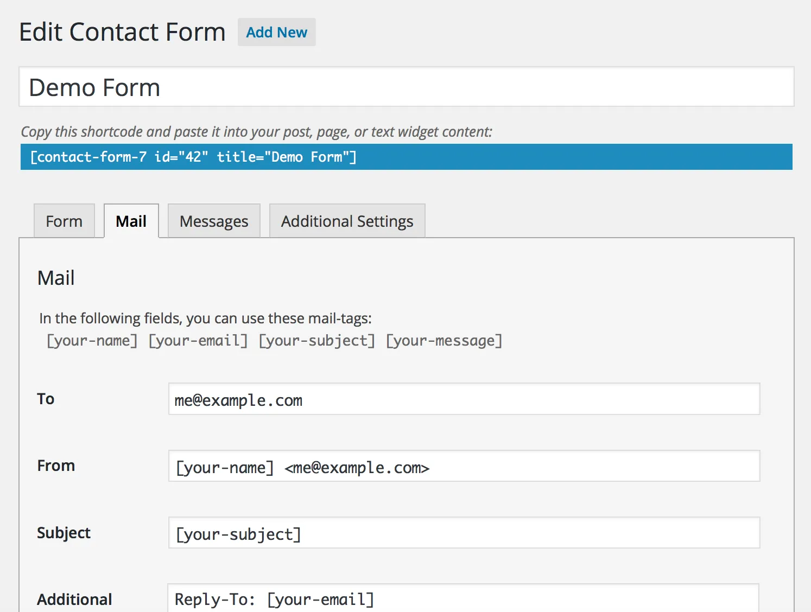

您可以非常灵活地编辑电子邮件模板。不仅是邮件正文，您还可以编辑邮件标题字段。如果需要，您甚至可以在消息中使用 HTML。
您可以在“[邮件”选项卡面板](https://contactform7.com/admin-screen/)中编辑电子邮件模板。

邮件标签面板

#### 字段[#到场](#to-field)

在此处设置收件人电子邮件地址。您可以在此字段中使用[邮件标签](https://contactform7.com/tag-syntax/#mail_tag)。
在有效的邮箱语法中指定值，否则[您将收到配置错误](https://contactform7.com/configuration-errors/invalid-mailbox-syntax/)。

#### 从字段[#来自外地](#from-field)

在此处设置发件人电子邮件地址。您可以在此字段中使用[邮件标签](https://contactform7.com/tag-syntax/#mail_tag)。
此字段值应该是与网站属于同一域的电子邮件地址。否则[你会得到一个配置错误](https://contactform7.com/configuration-errors/email-not-in-site-domain/)。

#### 主题字段[#学科领域](#subject-field)

在这里设置消息的主题。您可以在此字段中使用[邮件标签](https://contactform7.com/tag-syntax/#mail_tag)。

#### 附加标题[#附加标题](#additional-headers)

您可以在此处插入其他消息头字段，[例如 Cc 和 Bcc](https://contactform7.com/adding-cc-bcc-and-other-mail-headers/)。每行应该有一个字段。您可以在这些字段中的任何位置嵌入[邮件标签](https://contactform7.com/tag-syntax/#mail_tag)。

#### 消息正文[#邮件正文](#message-body)

这是消息体；您可以在该字段的任何位置嵌入[邮件标签](https://contactform7.com/tag-syntax/#mail_tag)。
如果您选中从输出中排除带有空白邮件标签的行复选框，则包含具有空值的邮件标签的行将从实际电子邮件输出的邮件正文中排除。
默认情况下，纯文本用于消息正文。要[使用 HTML](https://en.wikipedia.org/wiki/E-mail_header#Plain_text_and_HTML)，请选中使用 HTML 内容类型复选框。

#### 文件附件[#文件附件](#file-attachments)

如果您将[上传的文件](https://contactform7.com/file-uploading-and-attachment/)附加到此电子邮件，请将[上传文件的](https://contactform7.com/file-uploading-and-attachment/)[邮件标签](https://contactform7.com/tag-syntax/#mail_tag)放入文件附件字段。您还可以从服务器附加文件（[本地文件附件](https://contactform7.com/file-uploading-and-attachment/#local-file-attachment)）。

#### 邮件 (2) [#邮件 (2)](#mail-2)

邮件 (2)是一个附加的邮件模板。它通常用作自动回复器，但您可以将其用于任何目的。仅当主邮件已成功发送时才发送邮件 (2)。

#### 也可以看看

- [设置邮件的最佳实践](https://contactform7.com/best-practice-to-set-up-mail/)
- [特殊邮件标签](https://contactform7.com/special-mail-tags/)
