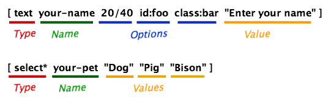
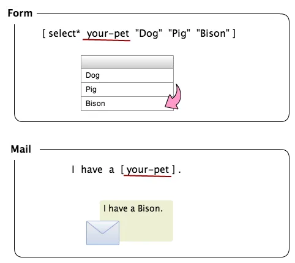

您可以使用各种类型的标签（用方括号括起来的字符串）来编辑表单和电子邮件的模板。Contact Form 7 为表单模板和电子邮件模板提供了两种不同类型的标签：[form-tags](#form_tag)和[mail-tags](#mail_tag)。
这两种类型的语法完全不同。例如，您`[text* your-name]`在表单模板和`[your-name]`电子邮件模板中使用。

#### 表单标签语法[#表单标签语法](#form_tag)

表单模板中的标签 (form-tag) 将被替换为 HTML 代码段，该代码段在呈现表单时表示输入字段。表单标签的组件可以分为四部分：类型、名称、选项和值。

类型是最重要的因素，因为它定义了将替换自己的 HTML 元素的类型，以及期望通过它的输入类型。
名称用于标识输入字段。大多数表单标签都有一个名称，但也有例外。
选项指定行为和外观的细节。选项是可选的。
在大多数情况下，值用于指定默认值。这些值也可能用于其他目的；这取决于标签的类型。值是可选的。
请注意，这些部分的顺序很重要。选项不能在名称之前，值不能在选项之前。

##### 表单标签类型列表

- [文本字段](https://contactform7.com/text-fields/ "文本字段")（`text`，`text*`，`email`，`email*`，`tel`，`tel*`，`url`，`url*`，`textarea`和`textarea*`）
- [数字字段](https://contactform7.com/number-fields/ "数字字段")（`number`，`number*`，`range`和`range*`）
- [日期字段](https://contactform7.com/date-field/ "日期字段")（`date`和`date*`）
- [复选框，单选按钮，和菜单](https://contactform7.com/checkboxes-radio-buttons-and-menus/ "复选框、单选按钮和菜单")（`checkbox`，`checkbox*`，`radio`，`select`和`select*`）
- [文件上传字段](https://contactform7.com/file-uploading-and-attachment/ "文件上传和附件")（`file`和`file*`）
- [测验](https://contactform7.com/quiz/ "测验")( `quiz`)
- [接受复选框](https://contactform7.com/acceptance-checkbox/ "验收复选框")( `acceptance`)
- [提交按钮](https://contactform7.com/submit-button/ "提交按钮")( `submit`)

#### 邮件标签语法[#邮件标签语法](#mail_tag)

邮件模板 (mail-tag) 中的标签要简单得多。邮件标签中只有一个词。在大多数情况下，这个词对应一个表单标签的名称，它会被通过它输入的表单替换。

